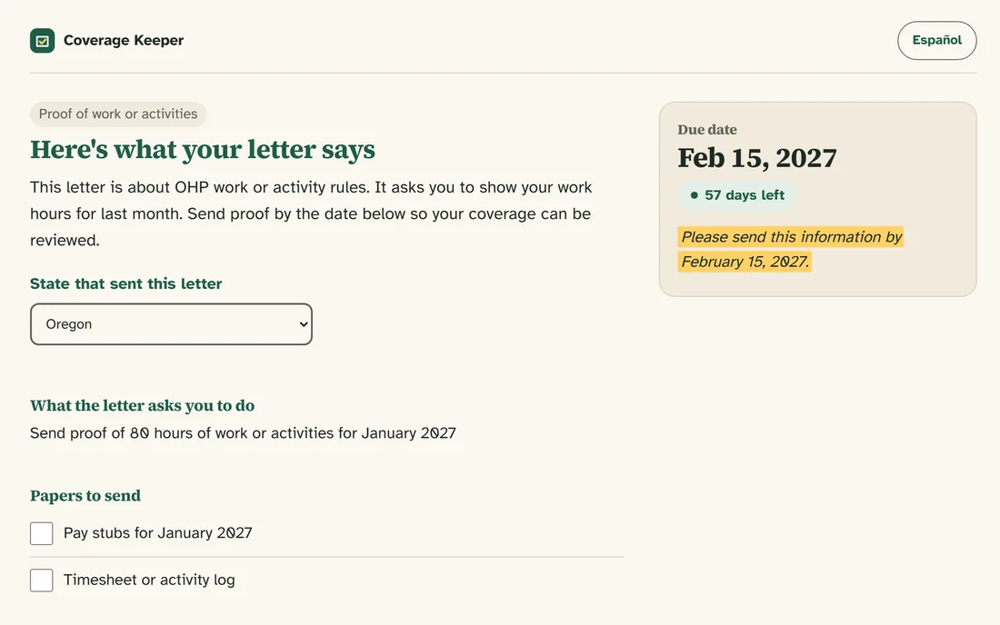
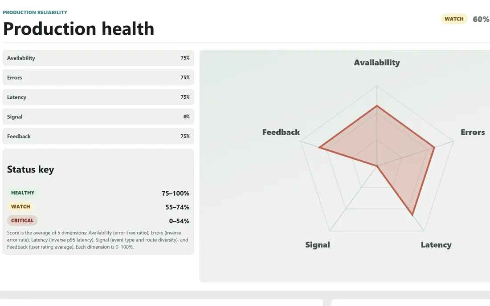
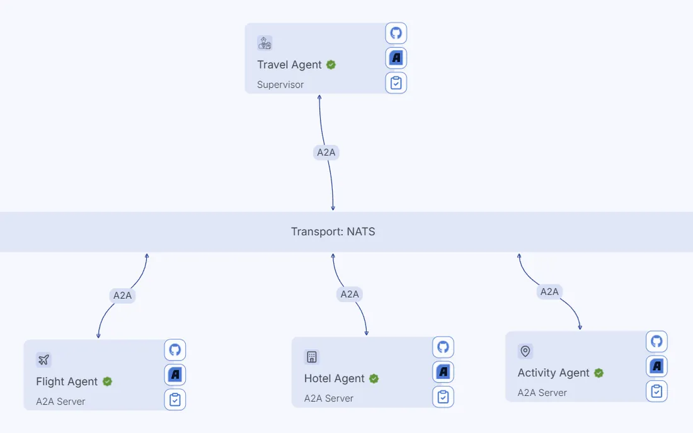

### I build software and find where it breaks.

Aditya Jadhav, software engineer and Security Engineer at UC San Diego. 
Graduating June 2027 and open to new-grad software engineering roles.

 

<table>
<tr>
<td align="center" valign="top" width="50%"><h3>3x</h3>hackathon winner</td>
<td align="center" valign="top" width="50%"><h3>24 of 24</h3>deadlines read right on Coverage Keeper's test letters</td>
</tr>
<tr>
<td align="center" valign="top" width="50%"><h3>11</h3>engineers led on WatchTower</td>
<td align="center" valign="top" width="50%"><h3>178</h3>integration tests gating Stockroom's CI</td>
</tr>
</table>

 

## Projects

### [Coverage Keeper](https://adityajadhav.dev/projects/coverage-keeper/)
*Winner, AI in Healthcare track, Solix AI Hackathon 2026*

**Got the deadline right on 24 of 24 test letters.** Photograph a Medicaid letter and see what it asks for, when it is due, and who to call. In a team of three, I built the interface, the rules for five states, English and Spanish support, the eval scoring and the security audit fixes.

[Case study](https://adityajadhav.dev/projects/coverage-keeper/) · [Code](https://github.com/AdityaJadhav17/coverage-keeper) · [Live app](https://coverage-keeper.vercel.app) &nbsp;|&nbsp; *Next.js · TypeScript · Claude API · zod · Vitest · Playwright · Vercel*

 

### [WatchTower](https://adityajadhav.dev/projects/watchtower/)
*UC San Diego course project (CSE 110)*

**Led 11 engineers to a deployed SDK, ingest API and live dashboard.** WatchTower shows web teams the errors, slowdowns and user activity on their live site. I was team lead, Scrum Master and technical lead for CI/CD and architecture. My own code is the CI pipeline, the Clerk sign-in and per-account data isolation, and in a later security review I found and closed three access-control holes.

[Case study](https://adityajadhav.dev/projects/watchtower/) · [Code](https://github.com/cse110-sp26-group09/Watchtower-Course-Project) · [Live dashboard](https://cse110-sp26-group09.github.io/Watchtower-Course-Project/) &nbsp;|&nbsp; *JavaScript · Node.js · Supabase · Clerk · Jest · Playwright · Render*

 

### [TravelAGNTCY](https://adityajadhav.dev/projects/travel-agntcy/)
*Won Cisco's AGNTCY track at SANDHacks 2026*

**Got responses back about 40% faster by redesigning the supervisor-to-agent messages.** Separate AI agents for flights, hotels and activities work together on one travel plan. We built it at the hackathon on CoffeeAGNTCY, AGNTCY's sample multi-agent app; afterwards I added the CI pipeline, conversation memory, budgets and chat lifecycle recovery.

[Case study](https://adityajadhav.dev/projects/travel-agntcy/) · [Code](https://github.com/AdityaJadhav17/Travel-Agntcy) · [Demo video](https://youtu.be/T0EkJ9J_IQU) &nbsp;|&nbsp; *Python · FastAPI · LangGraph · React · TypeScript · Docker · NATS · SerpAPI*

 

### More projects

- **[Talk-to-Robot](https://adityajadhav.dev/projects/talk-to-robot/)**: end-to-end success falls from 98% to 50% while policy success holds at 93 to 100%, which places the failures in the language model's grounding, not the robot controller. A five-person CSE 190 study. [Code](https://github.com/YangLin14/Talk-to-Robot) · [Paper](https://adityajadhav.dev/llm-spatial-grounding-paper.pdf)
- **[Bayt Qareeb](https://adityajadhav.dev/projects/bayt-qareeb/)**: won a $200 prize at the MTC x Replit x Manara West Buildathon. A map-first housing and roommate finder for Muslim college students, open only to verified .edu students. [Code](https://github.com/waleedA13/Bayt-Qareeb) · [Live app](https://manara-west.vercel.app) · [Demo video](https://youtu.be/dgyNZPzzhyE)
- **[Stockroom](https://adityajadhav.dev/projects/stockroom/)**: 178 integration tests and 11 end-to-end cases gate a seven-job CI pipeline. A shared inventory and purchasing app that records who approved what, and when. [Code](https://github.com/AdityaJadhav17/Stockroom)
- **[Margin](https://adityajadhav.dev/projects/margin/)**: in daily use since September 2026, with no runtime dependencies beyond React. One app for deadlines, courses, notes and goals that runs in the browser, with no account and no cloud. [Code](https://github.com/AdityaJadhav17/Margin)
- **[Synthetic-to-Real Object Detection](https://adityajadhav.dev/projects/synthetic-to-real/)**: mAP@50 0.9175 on the private leaderboard, 0.9074 on the public one. An object detector trained only on synthetic images, built to work on real photos. [Code](https://github.com/AdityaJadhav17/Synthetic-to-Real-Object-Detection) · [Kaggle competition](https://www.kaggle.com/competitions/synthetic-2-real-object-detection-challenge)

 

## Experience

**Security Engineer, UC San Diego (ITS)** · Dec 2025 to present
- Develop and maintain Python-based scripts and SQL queries to analyze and validate enterprise security data across legacy and modern systems
- Work within defined security scopes and confidentiality requirements while collaborating with engineers and administrators

**Software Engineering Intern, Lumulus Technologies** · Jun to Sep 2026
- Built a Windows desktop application in Python/Qt for configuring and validating USB-connected hardware devices, replacing a legacy internal tool and a paid third-party subscription and cutting a 15 to 20 minute task to under 5 minutes

**B.S. Computer Science, UC San Diego** · Expected June 2027

**Certifications:** AWS Certified Cloud Practitioner ([verify](https://www.credly.com/badges/09d1646f-ca09-46fd-926b-6af8d878fb26/public_url)) · AWS Certified AI Practitioner ([verify](https://www.credly.com/badges/e761ec4f-7806-4d0f-b497-303cc5533086/public_url))

 

## Toolkit

| Area | Tools |
|:--|:--|
| **Languages** |  Python · TypeScript · JavaScript · C# · C · C++ · Java · SQL |
| **Frontend** |  React · Next.js · Vite |
| **Backend and data** |  FastAPI · Node.js · ASP.NET Core · Supabase · Postgres · SQLite · Prisma |
| **AI and ML** |  PyTorch · YOLOv8 · LangGraph · Claude API · Gemini · MuJoCo · Stable-Baselines3 |
| **Testing and DevOps** |  Docker · GitHub Actions · Vercel · Jest · Vitest · Playwright · xUnit · NATS |

 

Email [aditya.jadhav7910@gmail.com](mailto:aditya.jadhav7910@gmail.com) about new-grad roles, or read the full case studies at [adityajadhav.dev](https://adityajadhav.dev/).

